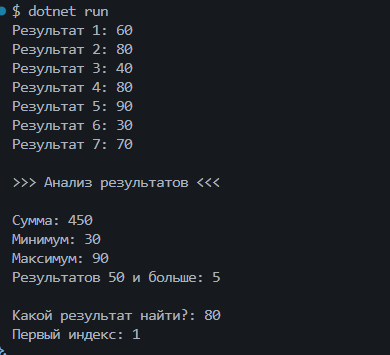

# Практическая работа №17

Автор: Магдеев Заур 
Группа: ИСП-254

## Тема

Алгоритмы обработки массивов.

## Что реализовано

- сумма элементов;
- подсчёт элементов по условию;
- минимум и максимум;
- линейный поиск;
- поиск первого индекса.

## Короткие ответы

1. Если числа будут все отрицательные число 0 будет самым большим. И может вернуть 0 которого нет в массиве 

2. Что такого значени нет в массиве 

3. Сумма складывает значение элементов а подсчет просто прибавляет 1 к кадому подходящему элементу

## Результат
